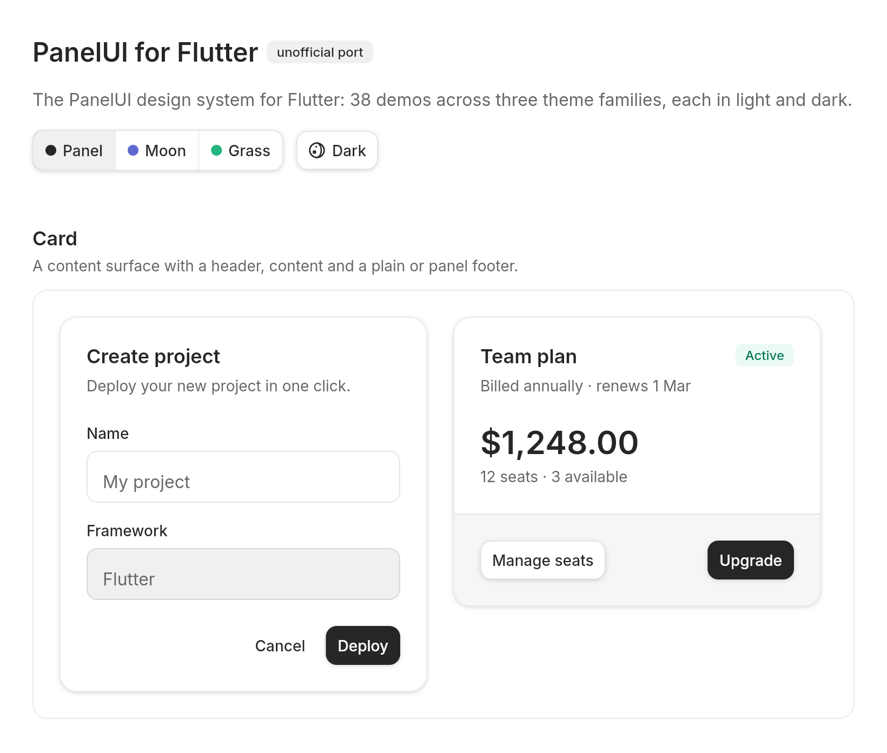
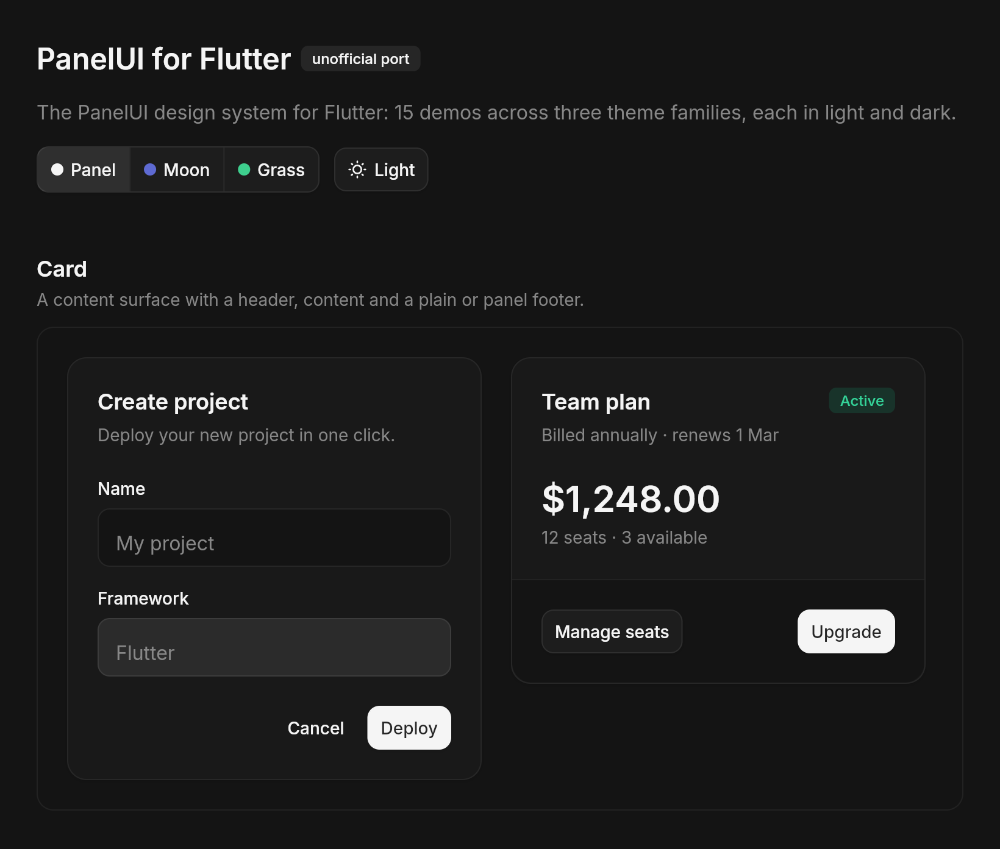
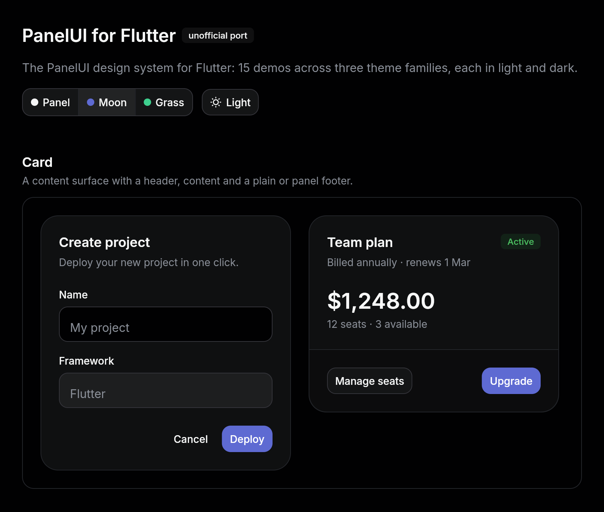

# PanelUI for Flutter

An unofficial Flutter port of [PanelUI](https://panelui.dev), the accessible,
animated component library for Expo. It has the same semantic design tokens,
the same three theme families in light and dark, the same icons, and the same
springs.

> Not affiliated with the PanelUI project. PanelUI is MIT-licensed by
> Khalid Abdi, and this port keeps that notice: see [LICENSE](LICENSE).

**Try it in the browser:** the gallery is published from `main` to
https://abdullahchauhan.github.io/panelui_flutter/. Every component has its
own page (`#/button`, `#/tabs`, …), and the theme family and brightness can be
switched from the sidebar.

| Panel, light | Panel, dark | Moon, dark |
| --- | --- | --- |
|  |  |  |

## Status

**43 of PanelUI's 141 components are ported**, along with the whole
foundation they stand on. [docs/COMPONENTS.md](docs/COMPONENTS.md) lists every
PanelUI component with its Flutter equivalent.

| Ported | |
| --- | --- |
| Foundation | Colour tokens and radius scales generated from PanelUI's `theme.css`; Panel, Moon and Grass, each light and dark; type scale; shadows; PanelUI's springs; press feedback; icons |
| Actions | Button, ButtonGroup, Chip, Menu, ToggleButton |
| Forms | Checkbox, Field, Input, Label, NumberInput, OtpInput, RadioGroup, Select, Slider, Switch, Textarea, ThemeSelector |
| Feedback | Alert, Badge, EmptyState, Meter, Progress, Skeleton, Spinner |
| Overlays | BottomSheet, Dialog, Popover, Toast, Tooltip |
| Navigation | Breadcrumb, Pagination, Steps, Tabs |
| Layout | Accordion, Card, Collapsible, Direction (Flutter's own `Directionality`), Item, ScrollFade, Separator, Surface, Typography |
| Media | Avatar |

Charts (21), the AI components (12) and most media, layout and data components
are still to come. [docs/PORTING.md](docs/PORTING.md) is the guide for porting
them.

## Install

The package is not on pub.dev yet. Add it from git:

```yaml
dependencies:
  panelui_flutter:
    git:
      url: https://github.com/AbdullahChauhan/panelui_flutter.git
```

It needs Flutter 3.38 or later.

## Quick start

Give your `MaterialApp` a PanelUI theme. Every component reads its tokens from
there, and Material widgets placed beside them share the palette.

```dart
import 'package:flutter/material.dart';
import 'package:panelui_flutter/panelui_flutter.dart';

void main() {
  runApp(
    MaterialApp(
      theme: PanelThemeData.panelLight.toMaterialTheme(),
      darkTheme: PanelThemeData.panelDark.toMaterialTheme(),
      home: const Scaffold(body: Center(child: CreateProject())),
    ),
  );
}

class CreateProject extends StatelessWidget {
  const CreateProject({super.key});

  @override
  Widget build(BuildContext context) {
    return SizedBox(
      width: 360,
      child: PanelCard(
        children: [
          const PanelCardHeader(
            title: Text('Create project'),
            description: Text('Deploy your new project in one click.'),
          ),
          const PanelCardContent(
            child: PanelInput(label: 'Name', placeholder: 'My project'),
          ),
          PanelCardFooter(
            mainAxisAlignment: MainAxisAlignment.end,
            children: [
              PanelButton(
                variant: PanelButtonVariant.ghost,
                size: PanelButtonSize.sm,
                onPressed: () {},
                child: const Text('Cancel'),
              ),
              PanelButton(
                size: PanelButtonSize.sm,
                onPressed: () {},
                child: const Text('Deploy'),
              ),
            ],
          ),
        ],
      ),
    );
  }
}
```

## Theming

A theme is a `PanelThemeData`: 58 colour tokens (`background`, `primary`,
`muted`, `destructive`, the surface ladder, status tints, syntax and chart
colours), a radius scale, a type scale and shadows. It is a `ThemeExtension`,
so `toMaterialTheme()` carries it inside a Material `ThemeData`, and switching
between light and dark crossfades every token.

```dart
// A family is a light and dark pair: panel, moon or grass.
const family = PanelThemeFamily.moon;
MaterialApp(
  theme: family.light.toMaterialTheme(),
  darkTheme: family.dark.toMaterialTheme(),
  themeMode: ThemeMode.system,
);

// Read tokens anywhere below it.
final theme = PanelTheme.of(context); // or context.panelTheme
Container(color: theme.colors.surface, child: ...);

// Make it your own: a brand colour and a font.
final brand = PanelThemeData.panelLight.copyWith(
  colors: PanelColors.panelLight.copyWith(primary: const Color(0xFF2563EB)),
  typography: const PanelTypography(fontFamily: 'Inter'),
);
```

To theme part of a screen differently, wrap it in
`PanelTheme(data: ..., child: ...)`. Apps without a Material theme can use
`PanelTheme` at the root instead.

The tokens are generated from PanelUI's own CSS, so they follow it exactly.
When PanelUI changes its palette, regenerate them:

```bash
dart run tool/generate_tokens.dart path/to/PanelUI/packages/panelui/theme.css
```

## From React Native to Flutter

| PanelUI | This port |
| --- | --- |
| Tailwind classes resolved by Uniwind (`bg-primary`, `rounded-lg`, `text-sm`) | `theme.colors.primary`, `theme.radii.lg`, `theme.typography.style(PanelTextSize.sm)` |
| Reanimated `withSpring({ damping, stiffness, mass })` | The same spring as a `SpringDescription` (`PanelSprings`), run with `controller.springTo()` |
| `AnimatedPressable`: shrink to 0.97 while pressed | `PanelPressable`, which also adds focus rings, hover and Enter/Space for web and desktop |
| `hitSlop` | `PanelPressable(hitSlop:)`, or `PanelHitSlop` around any widget |
| HugeIcons via `@hugeicons/react-native` | The same glyphs from the `hugeicons` package, painted directly as paths: `PanelIcon(PanelIcons.chevronDown)` |
| Compound parts: `Card.Header`, `Dialog.Content` | Separate widgets (`PanelCardHeader`) or named slots (`title:`) |
| `checked` / `onCheckedChange`, `startContent` / `endContent` | `value` / `onChanged`, `leading` / `trailing` |
| `useReducedMotion()` | `MediaQuery.disableAnimations`, honoured by every animation |

## Gallery

`example/` is a gallery of every ported component, grouped by PanelUI's
categories, with a theme-family switcher and a light/dark toggle. It is what
the published site runs.

```bash
cd example && flutter run -d chrome
```

On the web, `?family=moon&mode=dark#/tabs` opens the Tabs page in Moon's dark
theme.

## Development

```bash
flutter analyze
flutter test
cd example && flutter test
```

The last one is the gallery's smoke test: it builds every page in light and
dark. CI (`.github/workflows/ci.yml`) runs all three, plus a format check, on
every push and pull request, and publishes the gallery from `main`.

- `lib/src/theme/`: tokens (generated), theme data, typography, motion.
- `lib/src/foundation/`: `PanelPressable`, `PanelText`.
- `lib/src/components/`: one file per component.
- `tool/generate_tokens.dart`: regenerates the tokens from PanelUI's CSS.
- [docs/PORTING.md](docs/PORTING.md): how to port a component.

## License

MIT. See [LICENSE](LICENSE), which keeps PanelUI's copyright notice. The
gallery app bundles the Inter typeface under the SIL Open Font License
(`example/fonts/OFL.txt`).
